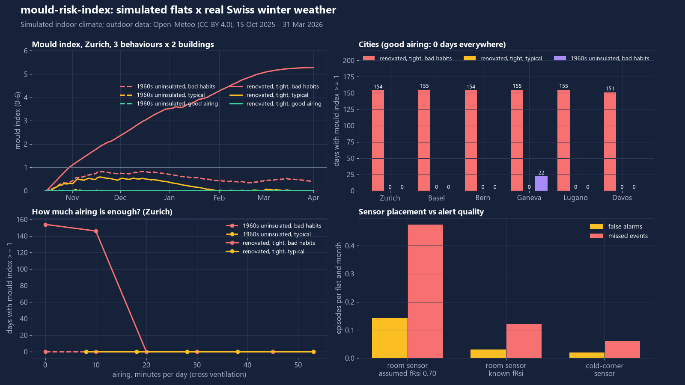

# mould-risk-index

Open-source mould and condensation risk monitor for rental flats: cheap temperature/humidity sensors in, wall-surface humidity, a mould index and plain-language advice (de/fr/it/en) out, with a tenant/landlord-neutral weekly report. All data stays local.



## What it does

- **Physics** (all unit-tested against published values): Magnus dew point and absolute humidity, inside surface temperature at a thermal bridge through the temperature factor fRsi, surface relative humidity, germination limit curve, the dynamic VTT mould index (Hukka and Viitanen), and the simple "80 % wall RH" rules (rolling window and monthly mean).
- **Sensor side**: a 7-byte open payload for LoRaWAN and BLE advertising, a Python codec plus a JavaScript uplink decoder (`codec/`), cheap-sensor error model (noise, per-unit offset), packet loss and multi-hour outages, gap handling that never invents data (short gaps interpolated, long gaps leave the index frozen and the coverage reported).
- **Advice engine**: small auditable rule set, e.g. "airing: open windows on opposite sides fully for 5 min now", "raise the heating setpoint by 1 K", "move wardrobes 5-10 cm from external walls", and it refuses to recommend airing when outdoor air is as moist as indoor air. German is de-CH spelling. Weekly report is rendered with jinja2 in four languages (`docs/example-report.*.md`).
- **Simulator**: a flat (60 m2, 2 people) with a heat balance and a moisture balance driven by real hourly outdoor weather for six Swiss cities; 3 behaviour scenarios x 2 building types.

## Results

Simulated flats, real outdoor weather (Open-Meteo, 15 Oct 2025 to 31 Mar 2026, Zurich unless noted). Mould class "sensitive" (painted plaster, assumption). Measured by `python -m mould_risk demo`; full tables in `docs/results.md`.

| Zurich, one winter | mould index max | days with index >= 1 | hours wall RH >= 80 % | mean room RH |
|---|---|---|---|---|
| renovated, tight, bad habits | 5.28 | 154 | 3967 | 83 % |
| renovated, tight, typical airing (8 min/day) | 0.59 | 0 | 1470 | 59 % |
| renovated, tight, good airing (25 min/day) | 0.02 | 0 | 142 | 46 % |
| 1960s uninsulated, bad habits | 0.84 | 0 | 2000 | 55 % |
| 1960s uninsulated, typical | 0.06 | 0 | 444 | 46 % |
| 1960s uninsulated, good airing | 0.01 | 0 | 82 | 42 % |

What changes the outcome (Zurich, `docs/results.md`):

- **Airing is a threshold, not a slope.** Renovated flat with bad habits: +10 min/day of cross ventilation still gives 146 days at index >= 1 (max index 1.78), +20 min/day gives 0 (max index 0.41). The old building with bad habits stays below index 1 (max 0.84) even without changes, although its wall RH is above 80 % for 2000 hours; +10 min/day lowers the max to 0.35. Raising the setpoint did not help the tight flat (+2 K: 155 days, max 4.96) but lowered the old one's max index (+1 K: 0.57, +2 K: 0.30). Airing costs heating energy: old building, bad habits, +10 min/day = +217 kWh (+6 %) over the season.
- **Cities** (days at index >= 1, renovated bad habits): 151 to 155 in all six cities; good airing: 0 in all six. Old building, bad habits: 0 days everywhere except Geneva (22 days). Differences between cities mostly show which side of a threshold a place falls on, not a ranking.
- **Advice in the loop** (sensor -> advice engine -> tenant follows with probability p), renovated flat, bad habits, cold-corner sensor: p = 0.7 cuts days at index >= 1 from 154 to 0 (max index 5.28 to 0.17); p = 0.3 also gives 0 days (max 0.85), while a room-centre sensor at p = 0.3 still allows 35 days (max 1.09). Heating energy rises from 565 to 1314 kWh because the unaired, cold flat was simply under-heated.
- **Alert counts** (noise-free wall RH, Zurich, 169 days): old building 79 / 28 / 7 warn episodes for bad / typical / good habits, renovated 4 / 58 / 14. The "good airing" warns are real short excursions (showers and cooking at the cold corner), not noise.
- **Sensor placement and false alarms** (6 flats x 3 noise seeds, 1.5 % RH noise + 1.5 % per-unit offset, 5 % packet loss, rare outages; mean over all six scenario flats): a cold-corner sensor gives 0.02 false-alarm episodes and 0.06 missed events per flat-month, hour-level recall 0.93. A room-centre sensor with the true fRsi: 0.03 / 0.12, recall 0.92. A room-centre sensor with a generic assumed fRsi of 0.70: 0.14 / 0.47, recall 0.74. The generic assumption mostly misses cold spots (fRsi lower than assumed) rather than raising false alarms.

## Quick start

```bash
python -m venv .venv && .venv/bin/pip install -e ".[dev]"     # Windows: .venv\Scripts\pip
python -m mould_risk demo                    # all experiments + figures + reports into docs/ (about 4 min)
python -m mould_risk demo --quick --no-figures --out /tmp/out   # 2 cities, about 1.5 min (CI)
python -m mould_risk advise --t-in 19 --rh-in 68 --t-out 0 --rh-out 85 --lang de
python -m mould_risk decode 10079118c66911        # 7-byte payload (hex)
python -m pytest -q
```

Sensor uplink decoder for a LoRaWAN network server: `codec/mould_sensor_decoder.js` (`decodeUplink`). Payload layout is documented in `mould_risk/sensors.py`.

## How it works


1. **Moist air**: saturation pressure and dew point with the Magnus form (Alduchov and Eskridge 1996).
2. **Surface**: `theta_si = theta_e + fRsi (theta_i - theta_e)`, surface RH = room vapour pressure / saturation pressure at `theta_si`. ISO 13788 is paywalled; the formulas are explained publicly (Wikipedia "Temperature factor"), and the DIN 4108-2 style threshold fRsi >= 0.70 (12.6 C wall at 20 C / 50 % indoors, -5 C outdoors) is reproduced in the tests. Which threshold applies in a Swiss lease dispute is a legal question this project does not answer.
3. **Mould**: germination limit `RHcrit(T) = -0.00267 T^3 + 0.160 T^2 - 3.13 T + 100` (Ojanen et al. 2010) and the dynamic mould index of Hukka and Viitanen (1999) with the material classes of Ojanen et al. (2010, Table 4: k1, A/B/C and RHmin per class), integrated hourly, with the published slow decline when conditions dry out (wood decline rate, Cmat = 1).
4. **Flat model**: one-zone moisture balance with hygric buffering (kappa 2.5), documented moisture production (people 35/45 g/h asleep/awake, shower 300 g, cooking 100-700 g, laundry 1.5 kg per load, rates from building-physics literature), RC heat balance with a proportional heater, infiltration rising with the temperature difference, airing as 12 air changes per hour for the stated minutes. See the `sim.py` docstring.
5. **Placement guidance**: monitor the coldest spot, usually the upper corner of an external wall or a window reveal, 5-10 cm off the surface, never behind a curtain or furniture; add one reference sensor at about 1.5 m in the room centre away from radiators and windows.

### Scenarios

| | bad habits | typical | good airing |
|---|---|---|---|
| setpoint day / night | 18.5 / 16 C | 20 / 18 C | 20.5 / 19 C |
| airing (cross ventilation) | none | 5 min at 07:00 and 20:00 | 10 min 07:00, 10 min 19:00, 8 min 22:00, plus 8 min at noon on weekends |
| laundry dried indoors | 3 loads per week | 1 per week | none |
| wardrobe against the cold corner | yes (fRsi -0.05) | no | no |

Buildings: 1960s uninsulated brick (UA 60 W/K, infiltration 0.50 per hour at 20 K, corner fRsi 0.62) and energy-renovated tight envelope (UA 15 W/K, 0.12 per hour, thermal-bridge fRsi 0.74, no mechanical ventilation). Both get 0.1 per hour of incidental ventilation while someone is awake at home.

## Data sources

- Outdoor hourly temperature and relative humidity: Open-Meteo Historical Weather API, https://open-meteo.com/en/docs/historical-weather-api, CC BY 4.0, "Weather data by Open-Meteo.com". Six cities (Zurich, Basel, Bern, Geneva, Lugano, Davos), 15 Oct 2025 to 31 Mar 2026, committed as CSV in `data/weather/` (about 100 kB each); `python -m mould_risk fetch` re-downloads. This is reanalysis/model-based gridded data, not a MeteoSwiss station measurement, and the grid elevation differs from the city centre (Davos grid 1569 m).
- Indoor climate: simulated (labelled as such everywhere).
- Mould model: Hukka and Viitanen (1999), Wood Sci. Technol. 33(6), 475-485; Ojanen, Viitanen, Peuhkuri, Lahdesmaki, Vinha and Salminen (2010), "Mold growth modeling of building structures using sensitivity classes of materials", Proc. Thermal Performance of the Exterior Envelopes of Whole Buildings XI (ASHRAE); Viitanen and Ojanen (2007), "Improved model to predict mold growth in building materials", Proc. Buildings X (ASHRAE).
- Magnus constants: Alduchov and Eskridge (1996), J. Appl. Meteorol. 35, 601-609.

## What is not verified yet

- Everything indoor is simulated. No real flat, no real sensor data and no real mould observation was used to validate the simulator or the mould predictions.
- The VTT constants were checked against Ojanen et al. (2010), Eq. 1-10 and Table 4, on 2026-11-09. An earlier version used the pine growth intensity (k1 = 1 / 2) and A = 0 for the "sensitive" class; the table gives k1 = 0.578 / 0.386 and A = 0.3, so all mould-index results were regenerated. Still my assumptions: the "sensitive" class for painted walls, applying the 85 % RHmin as a +5 point offset on the RHcrit curve, and the wood decline rate (Cmat = 1; the paper gives 0.1 to 0.5 for other materials, which would decline more slowly). Rerun with `very_sensitive` before relying on absolute index values.
- Moisture production rates, hygric buffering (kappa), infiltration scaling, the heater model and the behaviour schedules are plausible textbook-style values, not measured. The sharp airing thresholds above depend on them; treat them as "this kind of effect exists", not as ventilation recommendations.
- The simulator has one zone and one fixed cold spot, no solar gains, no mechanical ventilation, no condensation moisture sink beyond a 98 % room cap.
- The mould index here is cumulative with a slow decline, so "days at index >= 1" stays high after the wet period ends.
- Sensor noise numbers are typical datasheet-class assumptions, not measured sensors. The BLE and LoRaWAN formats are this project's own open format; no radio hardware was tested.
- Translations (de-CH, fr, it) were written without native-speaker review.
- The 0.70 fRsi reference is a widely quoted DIN 4108-2 value; Swiss SIA requirements were not checked. The report is an indicator, not a legal or expert assessment.
- I could not find a Swiss open-source tool with this scope, but that is a search result, not proof.

## Licence

MIT, Copyright (c) 2026 Victor Bonilla. See `LICENSE`.
